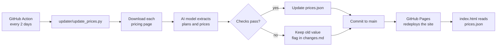

<div align="center">

# AI Tool Atlas

**Every AI tool, sorted by what it does. Free and paid kept apart, prices shown, refreshed automatically every 2 days.**

[](https://github.com/Sabyasachi-Kashyap/ai-tool-atlas/actions/workflows/update.yml)


[**Open the live site**](https://sabyasachi-kashyap.github.io/ai-tool-atlas/)

</div>

---

## What it is

A fast, searchable directory of AI tools for writing, images, video, voice, music, coding, productivity and meetings. For each tool you can see what it is good for, what you get **for free**, and what the **paid plans cost per month**.

Prices change constantly, so a robot checks each vendor's pricing page every 2 days and updates the site by itself.

## Features

- **Free and paid are separated.** A *Free tools* section and a *Paid-only tools* section, plus one-click Free / Paid / All views.
- **Real prices.** Every paid plan is listed with its monthly USD price. Free cards state the actual limits.
- **8 categories** with live counts: Chat assistants, Images, Video & avatars, Voice, Music, Coding, Writing & productivity, Research & meetings.
- **Instant search** across tool names, descriptions and categories.
- **Sort** by category or by lowest paid price.
- **Self-updating.** A scheduled GitHub Action refreshes the data every 2 days. No server to run.
- **Zero frontend dependencies.** One HTML file and one JSON file. No framework, no build step.
- **Accessible and responsive.** Real buttons and links, keyboard focus styles, good contrast, works down to phone width, respects reduced-motion settings.

## How it works



The website is static. `index.html` loads `prices.json` in the browser and draws everything from it. Updating prices means updating that one file.

## Repository layout

```
.
├── index.html                  # the whole website (HTML, CSS, JS in one file)
├── prices.json                 # all tools, plans and prices (the only file the robot edits)
├── changes.md                  # written on every run: what changed, what needs review
├── requirements.txt            # Python packages for the updater
├── updater/
│   └── update_prices.py        # reads pricing pages and refreshes prices.json
└── .github/workflows/
    └── update.yml              # the 2-day schedule
```

## Data format

Each tool in `prices.json` looks like this:

```json
{
  "name": "Example Tool",
  "cat": "image",
  "url": "https://example.com",
  "pricing_url": "https://example.com/pricing",
  "does": "One sentence on what it is good for.",
  "free": "What the free plan includes. Empty text means no free plan.",
  "plans": [
    { "n": "Pro", "p": "$20" },
    { "n": "Max", "p": "$60" }
  ],
  "from": 20,
  "last_checked": "2026-10-09"
}
```

| Field | Meaning |
|---|---|
| `cat` | One of the keys in `categories` at the top of the file |
| `free` | Free-plan limits. Empty means the tool is shown as paid-only |
| `plans` | Paid plans as shown on the vendor's page |
| `from` | Lowest paid monthly price in USD, or `null` if none or not monthly |
| `pricing_url` | The page the updater reads for this tool |

## Run it locally

```bash
git clone https://github.com/Sabyasachi-Kashyap/ai-tool-atlas.git
cd ai-tool-atlas
python -m http.server 8000
```

Open <http://localhost:8000>. A local server is needed because browsers block a page from reading `prices.json` when you open `index.html` straight from a folder.

## Run the updater yourself

```bash
pip install -r requirements.txt
export ANTHROPIC_API_KEY=your-key-here

python updater/update_prices.py --dry-run        # preview changes, write nothing
python updater/update_prices.py --only Claude    # test a single tool
python updater/update_prices.py                  # update everything
```

| Setting | Default | Purpose |
|---|---|---|
| `ANTHROPIC_API_KEY` | none, required | Lets the updater read pricing pages with an AI model |
| `ATLAS_MODEL` | `claude-haiku-5-5` | Which model reads the pages |

## Deploy your own copy

1. **Fork or copy** this repository to your own GitHub account (public repo for free Pages).
2. **Turn on the website:** Settings > Pages > Source: *Deploy from a branch* > branch `main`, folder `/ (root)`.
3. **Add your API key:** Settings > Secrets and variables > Actions > New repository secret, named `ANTHROPIC_API_KEY`.
4. **Run the first update:** Actions > *Update prices* > *Run workflow*. After that it runs every 2 days at 03:00 UTC.

The site works without step 3 and 4, it just won't refresh itself.

## Safety rules built into the updater

Wrong prices are worse than old prices, so the updater is cautious:

- A page that can't be downloaded, or has no readable prices, **never overwrites** an entry.
- Model answers are validated (plan names, price text, numeric ranges) before they are used.
- If the lowest price moves by more than **3x**, the change is **not applied** and is flagged for review instead.
- Every change is a Git commit, so any update can be undone from the history.
- The website escapes all text from `prices.json` and only links to `https://` addresses.

## Adding or fixing a tool

- **Add a tool:** add an entry to `prices.json` using the format above. The updater picks it up on the next run.
- **A tool shows under "Needs review":** open `changes.md`, then set that tool's `pricing_url` to the page that shows plans as plain text. Some vendors load prices with JavaScript, which a simple page download can't see.

## Limitations

- Prices are read from vendor pages by an AI model, so an unusual page layout can still produce a wrong or missing value. Skim `changes.md` after runs.
- Prices are in USD per month unless a plan says otherwise. Regional prices, taxes, yearly discounts and promotions vary.
- A tool is shown as paid-only when no free plan was found. It may still offer a trial.
- Open-source coding tools are free to install, but you pay your chosen AI provider for usage.
- The tool list reflects one moment in time. New tools and shutdowns are added by hand.

## Disclaimer

This is an independent directory. It is not affiliated with, endorsed by, or sponsored by any of the listed tools or companies. All product names belong to their owners. Always confirm current prices on the vendor's own website before you pay.
